# Figure captions and provenance

## 01 · Sampler sample/hold

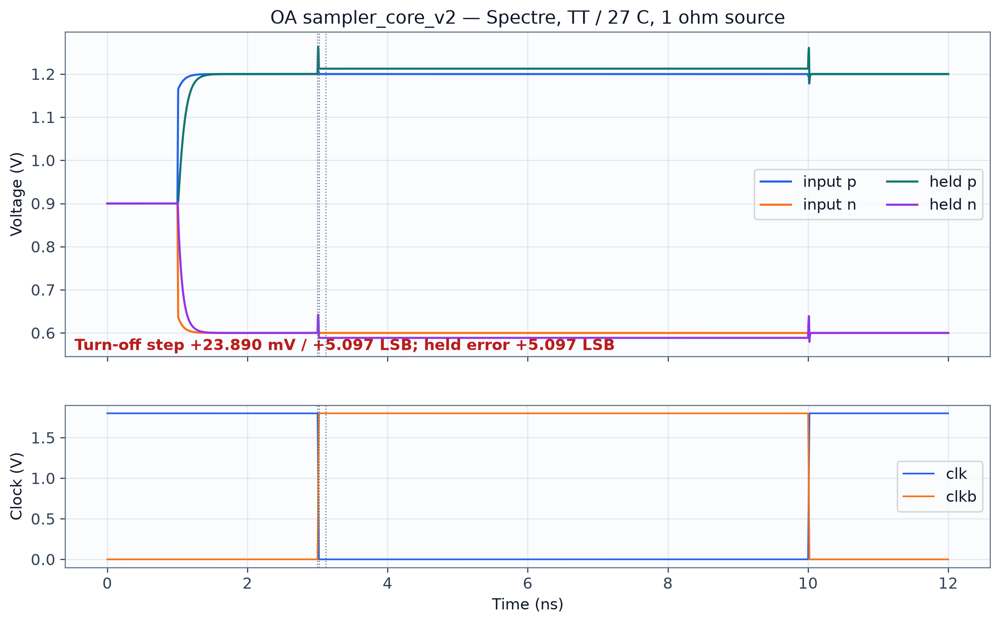

OA sampler_core_v2 Spectre vectors; TT, 27 C, VDD 1.8 V, 1 ohm source, +0.6 V differential. +23.890 mV switching step and +5.097 LSB held error.

**Source:** `results/physical/sampler_core_v2_OA_R1ohm/waveforms.npz`.

## 02 · CDAC switched response

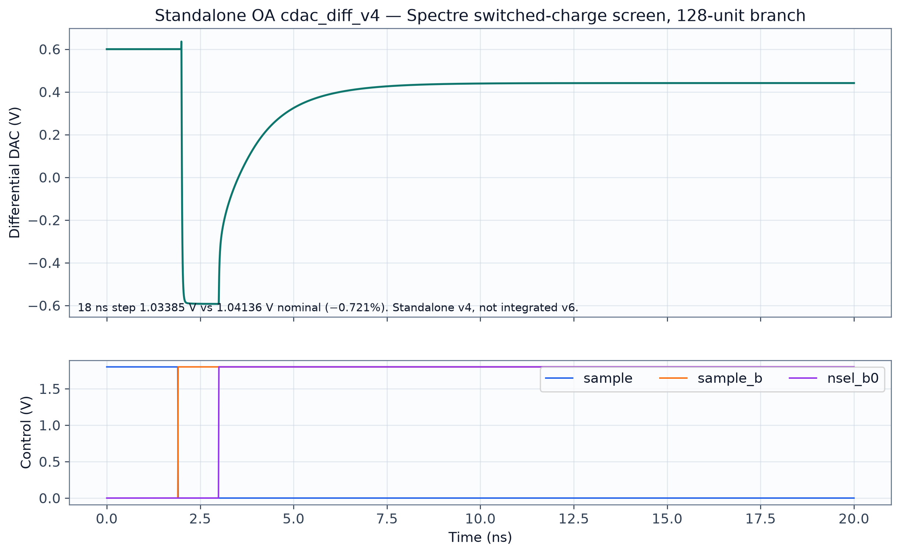

Standalone OA cdac_diff_v4 transistor-level Spectre, bit-0 screen. Explicitly not the integrated cdac_diff_v6.

**Source:** `results/physical/cdac_diff_v4_spectre/bit0/waveforms.npz`.

## 03 · CDAC branch transfer screen

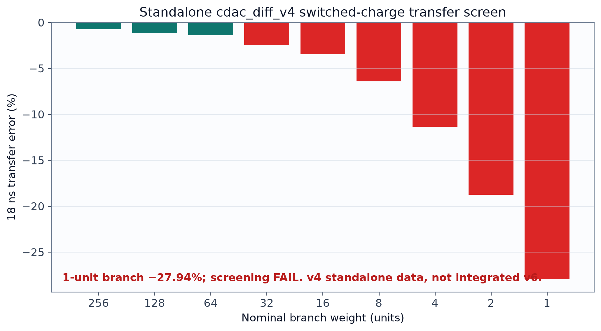

Saved Spectre weight_transfer.csv. 1-unit branch is −27.94% after 18 ns; screening failure.

**Source:** `results/physical/cdac_diff_v4_spectre/weight_transfer.csv`.

## 04 · Comparator regeneration

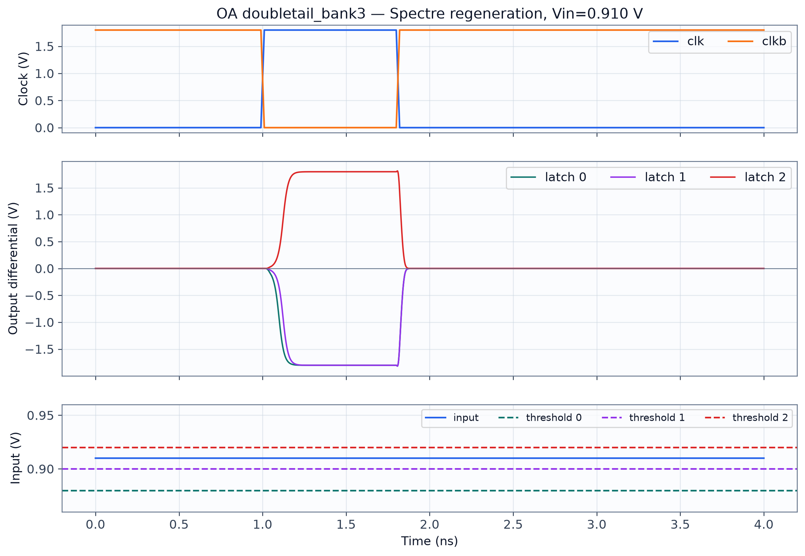

Actual transistor-level doubletail_bank3 standalone Spectre waveform vectors at Vin=0.910 V.

**Source:** `results/physical/comparator_bank3_spectre/case2_vin910mV/waveforms.npz`.

## 05 · Five-decision transactions

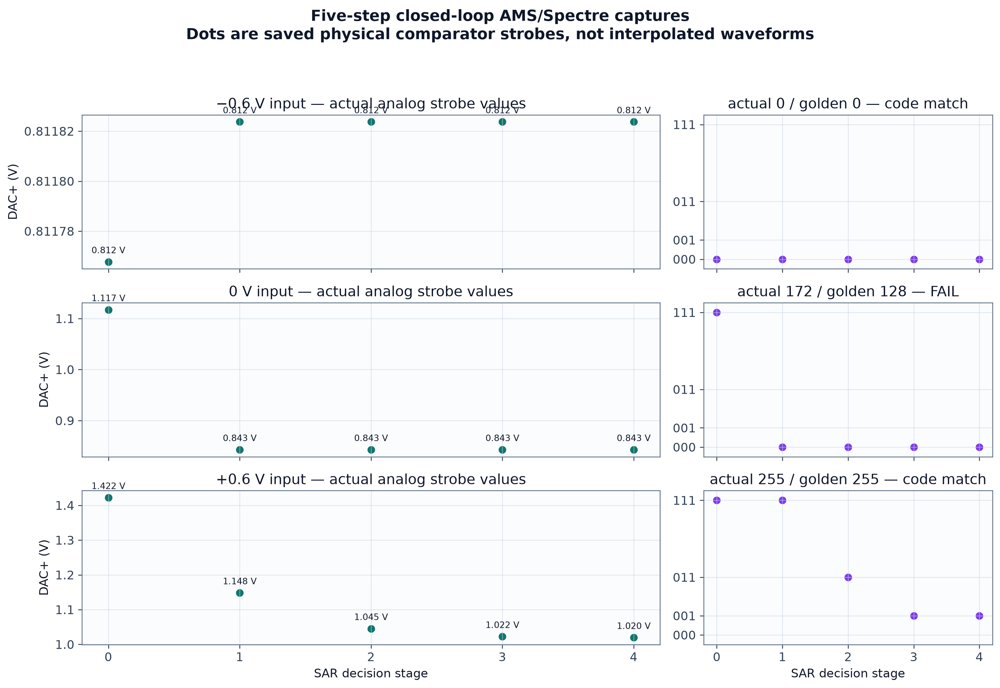

Actual AMS/Spectre comparator strobe samples and final code summary. Dots are sampled results, not a continuous waveform reconstruction.

**Source:** `results/raw/first_integrated_adc_capture/case_summary.csv; case xrun logs`.

## 06 · Simulator checkpoint comparison

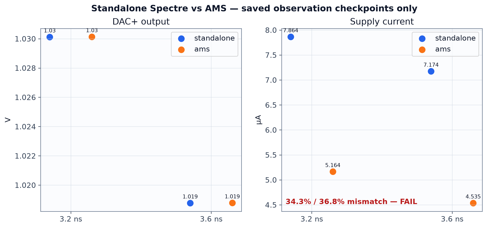

Saved two-time-point DAC and supply-current comparison. Current equivalence remains failed.

**Source:** `results/physical/ams_oa_source_flow_20261013/comparison_edge_aligned_reltol1e-5.json`.

## 07 · Genus critical path

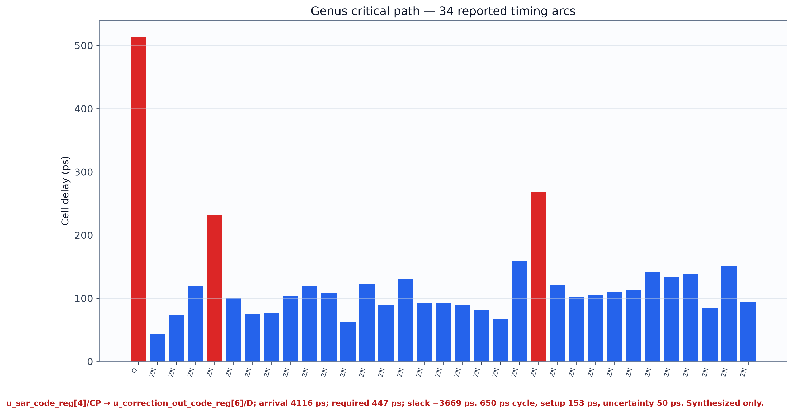

Saved Genus detailed timing report, synthesized digital wrapper. 34 reported timing arcs, −3.669 ns slack.

**Source:** `results/digital/channel_wrapper_20261013/timing.rpt`.

## 08 · OA analog hierarchy

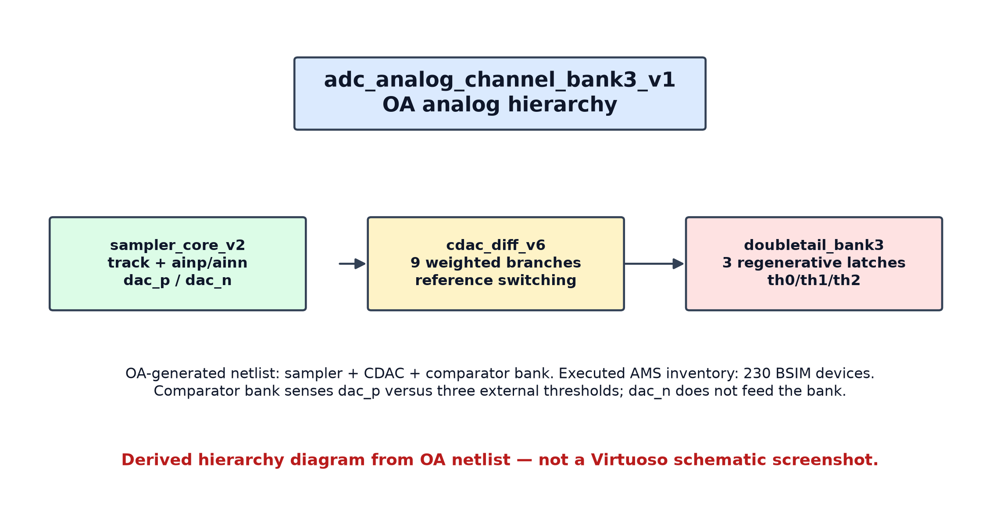

Reconstructed from generated OA Spectre netlist. Not a Virtuoso screenshot or schematic export.

**Source:** `results/physical/adc_analog_channel_bank3_netlist/ocean_output/spectre/schematic/netlist/input.scs`.

## 09 · AMS feedback dataflow

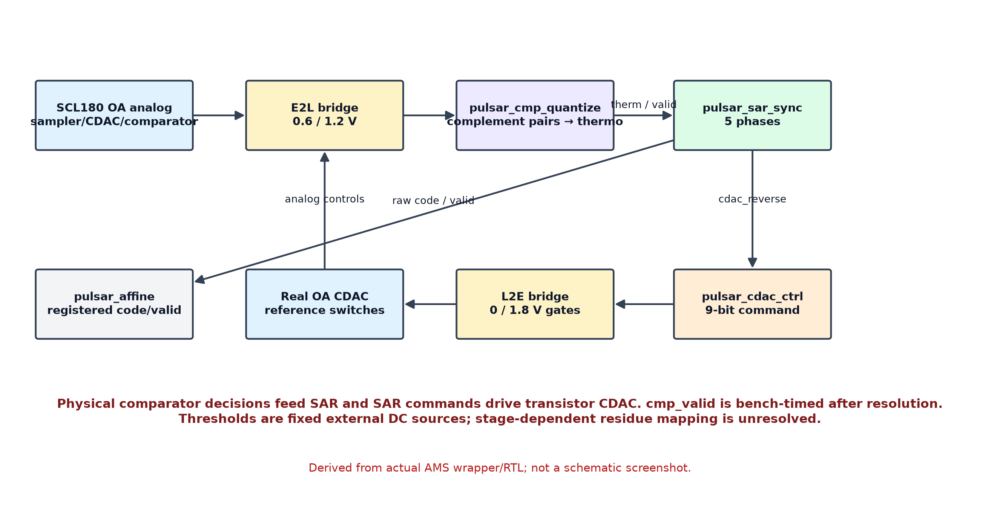

Reconstructed from AMS wrapper and RTL module connections; not an EDA screenshot.

**Source:** `results/raw/first_integrated_adc_capture/cases/zero/ams_feedback_top.vams; digital/rtl/`.

## 10 · Existing five-decision AMS conversion timing plot

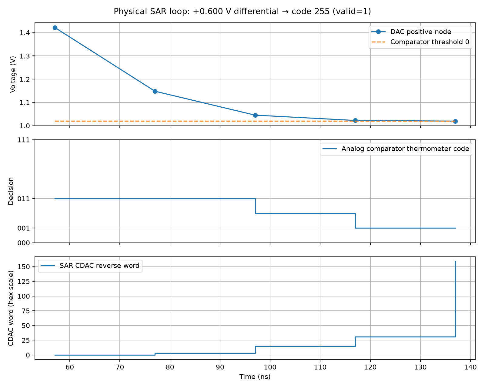

Copied byte-for-byte from the previously saved first-integration capture. It combines DAC+ strobe samples, physical comparator thermometer decisions and SAR CDAC command word over the transaction; final output is 255 with valid asserted. The DAC+ dots are five comparator-strobe samples; connecting line segments are visual guides, not a continuous waveform. The physical and golden decision sequences differ, so this is feedback-function evidence rather than accuracy evidence.

**Source:** `results/raw/first_integrated_adc_capture/conversion_timing.png`, `capture.json`, `stages.csv`.

## 11 · Genus area and timing summary

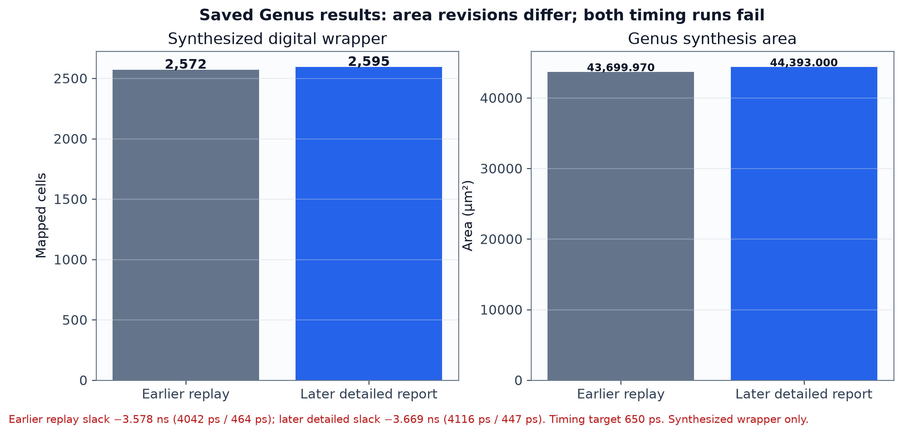

Both saved area revisions are shown: earlier replay 2,572 cells / 43,699.970 µm²; later report 2,595 / 44,393 µm². Both saved critical paths fail the 650 ps timing requirement. These are synthesis reports for the digital wrapper, not full-chip area or routed timing.

**Sources:** `results/digital/channel_wrapper_20261013/replay.json`, `area.rpt`, `timing.rpt`.
